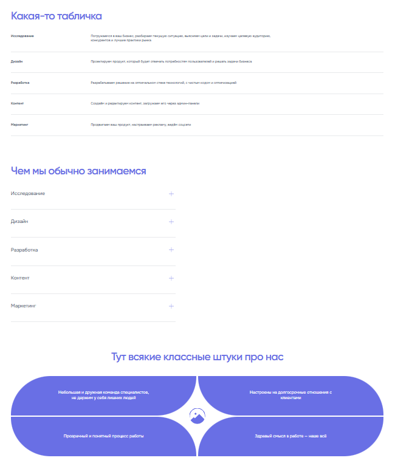
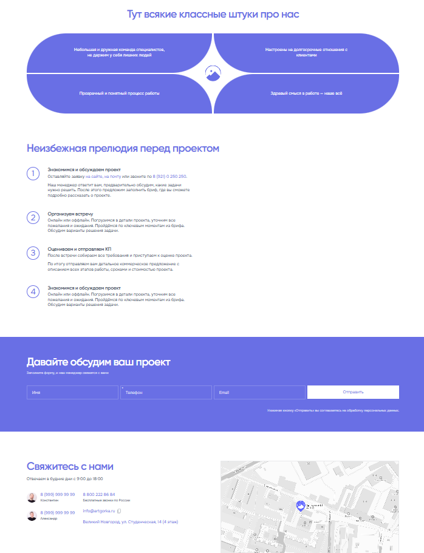
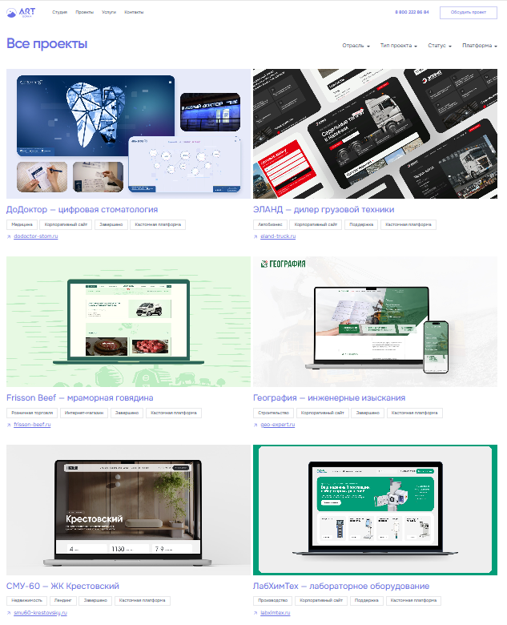
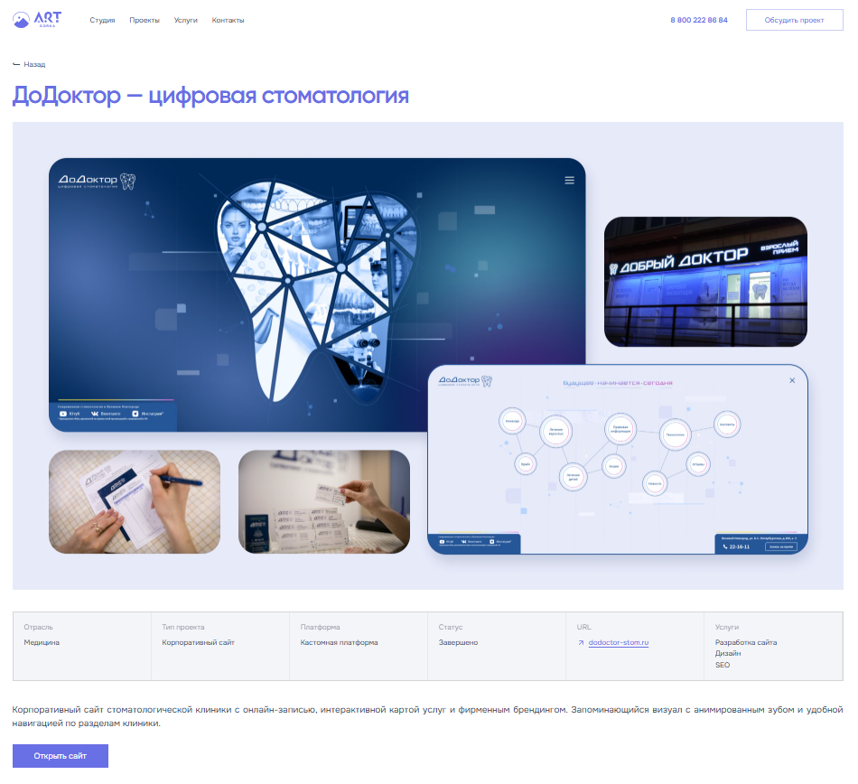
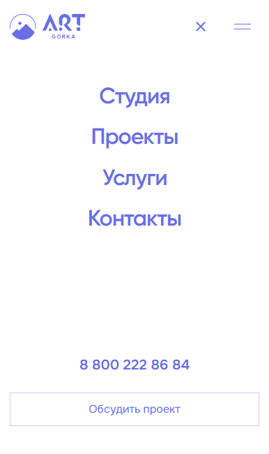
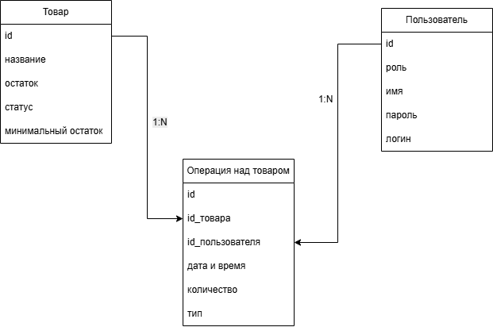
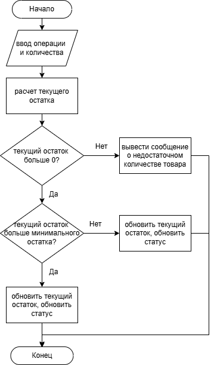

# Отчёт по производственной практике — Art Gorka

**Студентка:** Владимирова В. О., группа 3993 · Политехнический колледж НовГУ им. Ярослава Мудрого
**Специальность:** 09.02.07 «Информационные системы и программирование», ПМ.05 «Проектирование и разработка информационных систем»
**Период:** июнь 2026

Оригиналы: [ArtGorka_otchet_po_praktike.docx](ArtGorka_otchet_po_praktike.docx) · [ArtGorka_otchet_po_praktike.pdf](ArtGorka_otchet_po_praktike.pdf)
Тестовая документация, собранная из отчёта: [TEST_DOCUMENTATION.md](TEST_DOCUMENTATION.md)

> Markdown-версия сконвертирована из Word-файла для удобного чтения на GitHub. При расхождениях ориентируйтесь на оригинал.

## Введение

Производственная практика является неотъемлемой частью образовательного процесса, направленной на закрепление теоретических знаний, полученных в ходе обучения, и приобретение практических навыков работы по специальности. Практика проходила в студии веб-разработки Art Gorka, специализирующейся на создании корпоративных сайтов, интернет-магазинов и веб-приложений под ключ. Выбор места практики обусловлен соответствием студии профилю подготовки, а также возможностью участия в реальном проекте, что позволяет применить полученные в процессе обучения компетенции в условиях, максимально приближенных к профессиональной деятельности.

Целью производственной практики являлось получение практических навыков разработки клиентской части веб-приложения в условиях реальной производственной среды, включая анализ дизайн-макетов, реализацию адаптивного пользовательского интерфейса и интеграцию с серверным REST API. Для достижения поставленной цели в рамках практики решались следующие задачи: ознакомление с регламентами, нормами охраны труда и внутренними стандартами предприятия; изучение технологического стека и инструментов, применяемых в веб-студии; реализация фронтенд-части учебного проекта «Портфолио проектов студии», включающей главную страницу, каталог проектов с фильтрацией и страницу отдельного проекта; обеспечение адаптивности интерфейса для трёх контрольных разрешений, соответствующих настольным компьютерам, планшетам и мобильным устройствам; реализация интеграции фронтенда с REST API посредством HTTP-запросов; проведение функционального тестирования разработанного приложения.

Актуальность темы обусловлена необходимостью создания надёжного инструмента для ведения портфолио студии — демонстрационной площадки выполненных работ, которая одновременно служит витриной для потенциальных клиентов и внутренним каталогом проектов. В условиях цифровой экономики наличие качественного портфолио становится критическим фактором успеха веб-студии, а удобный и отзывчивый пользовательский интерфейс портфолио напрямую влияет на восприятие компании клиентами и на эффективность представления выполненных работ.

Объектом исследования в рамках практики выступает процесс разработки клиентской части веб-приложения для представления проектов, а предметом — методы и средства реализации одностраничного приложения на основе библиотеки React с использованием сборщика Vite и взаимодействием с REST API.

## Техника безопасности на предприятии

До начала производственной практики был проведён вводный инструктаж по охране труда и технике безопасности, в ходе которого были рассмотрены основные правила организации рабочего места, режима работы с вычислительной техникой, пожарной и информационной безопасности.

Рабочее место оборудовано персональным компьютером, соответствующим эргономическим требованиям. Монитор установлен на расстоянии 50–70 сантиметров от глаз пользователя, при этом верхняя граница экрана располагается на уровне либо немного ниже линии взгляда. Рабочий стул оснащён регулировкой высоты, позволяющей поддерживать правильную осанку в течение рабочего дня. Освещение рабочего места является комбинированным, естественным и искусственным, и соответствует санитарным нормам, что снижает нагрузку на зрительный аппарат и предотвращает преждевременное утомление.

В соответствии с санитарно-гигиеническими требованиями непрерывная работа за компьютером не должна превышать двух часов, после чего предусмотрен обязательный перерыв продолжительностью 10–15 минут для восстановления работоспособности и снятия зрительного напряжения. Запрещается эксплуатация оборудования при наличии повреждений кабелей питания или периферийных устройств. При временном оставлении рабочего места осуществляется блокировка пользовательской сессии во избежание несанкционированного доступа к информации.

В области пожарной безопасности установлен запрет на курение на территории офиса, а по окончании рабочего дня все нестационарные электроприборы подлежат отключению от сети для предотвращения коротких замыканий и возгораний. Схемы эвакуации при возникновении пожара доведены до сотрудников в ходе вводного инструктажа, места расположения первичных средств пожаротушения изучены.

Обеспечение информационной безопасности осуществляется в соответствии с политикой коммерческой тайны студии: хранение паролей и ключей доступа в незащищённых файлах запрещено, конфигурационные параметры выносятся в переменные окружения и не размещаются в системе контроля версий. Рабочие материалы размещаются исключительно в согласованных репозиториях системы контроля версий. В рамках практики использовались тестовые данные без применения реальной информации клиентов.

## Должностные обязанности

В соответствии с индивидуальным планом работы и должностной инструкцией в период прохождения практики выполнялись функции фронтенд-разработчика, связанные с разработкой клиентской части веб-приложения «Портфолио проектов студии». На основе анализа дизайн-макетов и требований к проекту было необходимо спроектировать и реализовать одностраничное приложение, или SPA, на библиотеке React, обеспечивающее отображение каталога проектов студии, фильтрацию по параметрам, просмотр детальной информации о проекте и отправку заявки на обратную связь.

В область выполняемых обязанностей входил анализ дизайн-макетов в среде Figma и декомпозиция интерфейса на составляющие компоненты, а также разработка адаптивной вёрстки страниц одностраничного приложения. На основе результатов декомпозиции выполнялась реализация переиспользуемых React-компонентов и разработка пользовательских хуков для инкапсуляции логики работы с данными и состоянием приложения. Отдельной задачей являлась настройка клиентской маршрутизации с использованием библиотеки React Router.

Значительная часть работ была связана с интеграцией клиентской части с REST API серверной части, включая формирование HTTP-запросов, обработку получаемых данных, а также корректную обработку состояний загрузки и ошибок. В обязанности также входила настройка сборки проекта с использованием инструмента Vite, участие в согласовании формата взаимодействия между клиентской и серверной частями приложения и ведение технической документации проекта.

## Программное обеспечение

В процессе выполнения работ использовался следующий инструментарий и программное обеспечение, выбор которого обусловлен требованиями проекта и корпоративными стандартами студии Art Gorka.

В качестве среды выполнения JavaScript применялась платформа Node.js версии 20, а для управления зависимостями проекта — пакетный менеджер npm версии 10. Сборка проекта и запуск локального сервера разработки осуществлялись инструментом Vite, обеспечивающим быстрый старт и горячую замену модулей. Для статического анализа исходного кода и контроля соблюдения стандартов оформления использовался ESLint.

Клиентская часть разработана на языке JavaScript с использованием библиотеки React версии 19, выбор которой обусловлен компонентным подходом, декларативным описанием пользовательского интерфейса, наличием механизма хуков и широким распространением в коммерческой разработке. Для организации навигации без перезагрузки страницы применена библиотека React Router DOM версии 7. Стилизация интерфейса выполнена средствами CSS без использования сторонних UI-фреймворков, что обеспечивает полный контроль над внешним видом и адаптивностью приложения.

В качестве основной интегрированной среды разработки выбран Visual Studio Code — кроссплатформенный редактор с широкими возможностями расширения функциональности. Для хранения исходного кода и совместной работы использовались система контроля версий Git и платформа GitHub. Источником дизайн-макетов служил сервис Figma. Для тестирования API-запросов применялось приложение Postman, а для отладки и проверки адаптивности интерфейса — инструменты разработчика браузера Google Chrome, известные как Chrome DevTools.

## 4 Специальное практическое задание

### 4.1 Техническое задание

Целью проекта являлась разработка веб-приложения «Портфолио проектов студии Art Gorka», представляющего собой публичную витрину проектов с возможностью фильтрации и просмотра детальной информации. Веб-приложение проектировалось как SPA, взаимодействующее с серверной частью по протоколу HTTP посредством REST API.

В рамках проекта предусматривалась реализация трёх страниц: главной страницы с информацией о студии; страницы каталога проектов, отображающей список проектов с возможностью фильтрации; и детальной страницы отдельного проекта, представляющей подробную информацию о выбранном проекте.

Функциональные требования к главной странице предусматривали наличие информационных блоков о студии, секции часто задаваемых вопросов в формате аккордеона, формы обратной связи с валидацией пользовательского ввода и модального окна подтверждения успешной отправки. Страница каталога проектов должна обеспечивать загрузку списка проектов из API, фильтрацию по параметрам отрасли, типа проекта, платформы, статуса и услуги, анимацию обновления карточек при изменении фильтров, а также отображение сообщения при отсутствии результатов. Детальная страница проекта предназначена для загрузки данных по идентификатору, отображения полной информации о проекте и корректной обработки ситуации обращения к несуществующему проекту с возвратом ошибки 404.

Требования к системе включали адаптивную вёрстку для трёх контрольных разрешений, соответствующих настольным компьютерам, планшетам и мобильным устройствам, а также обеспечение базовой доступности. Взаимодействие с серверной частью реализуется посредством GET-запросов и предусматривает получение списка проектов с применением фильтрации, доступных значений параметров фильтрации и отдельного проекта по идентификатору.

### 4.2 Разработка

Приложение реализовано как SPA на базе библиотеки React. Клиентская маршрутизация выполнена с использованием библиотеки React Router, а сборка проекта осуществляется инструментом Vite. Архитектура приложения построена по модульному принципу с разделением исходного кода на страницы, компоненты, пользовательские хуки, сервисы и утилиты, что обеспечивает изоляцию ответственности и упрощает сопровождение и расширение приложения.

Структура проекта организована по функциональному принципу. В каталоге src/pages размещены компоненты страниц, соответствующие маршрутам приложения; в каталоге src/components — переиспользуемые компоненты интерфейса, каждый в отдельной директории с разметкой, стилями и точкой входа; в каталоге src/hooks — пользовательские хуки, инкапсулирующие логику работы с данными и состоянием; в каталоге src/api — модуль взаимодействия с REST API; в каталогах src/utils и src/constants — вспомогательные функции и статические данные; в каталоге src/context — глобальный контекст управления состоянием модальных окон.

В рамках проекта реализован 21 компонент, разделённый по функциональным группам: элементы навигации и структуры страницы, компоненты каталога проектов и карточек, информационные блоки главной страницы, компоненты формы обратной связи и модальных окон, а также вспомогательные элементы интерфейса. Такое разделение обеспечивает переиспользование компонентов и упрощает сопровождение кода.

Главная страница объединяет основные информационные блоки и управляет отображением модальных окон через глобальный контекст React. Страница каталога реализует загрузку данных посредством пользовательского хука useProjects и динамическую фильтрацию проектов. Детальная страница отображает подробную информацию о проекте и обрабатывает состояние ошибки 404 при обращении к несуществующему проекту.

Логика приложения инкапсулирована в пользовательских хуках, каждый из которых отвечает за отдельную задачу: загрузку и фильтрацию проектов, получение доступных параметров фильтрации, управление формой обратной связи и валидацию введённых данных, управление модальным окном, а также анимацию обновления сетки карточек при изменении набора фильтров. Примеры кода представлены в Листинге под пунктами А.1-А.4.

Адаптивность интерфейса реализована с использованием CSS-медиазапросов без применения сторонних фреймворков. Выделены три контрольных разрешения: настольные устройства с шириной экрана от 1024 пикселей, планшеты с шириной экрана от 768 до 1023 пикселей и мобильные устройства с шириной экрана менее 768 пикселей. Для каждого из диапазонов обеспечено корректное отображение шапки сайта, сетки карточек проектов и модальных окон. Дизайн проекта представлен в Приложении Б.

### 4.3 Тестирование

Тестирование разработанного функционала проводилось вручную в браузере Google Chrome с использованием инструментов разработчика. По результатам проверки фиксировались выявленные недочёты и результаты выполненных исправлений.

В ходе проверки контролировались корректность отображения интерфейса, работа секции аккордеона, функционирование модальных окон, валидация формы обратной связи, фильтрация проектов, переход на детальную страницу проекта и обработка ошибок при обращении к API. Все предусмотренные сценарии работы приложения были выполнены корректно.

Адаптивное тестирование проводилось на контрольных разрешениях 1440×900, 768×1024 и 375×812 пикселей, соответствующих настольным, планшетным и мобильным устройствам. Искажений интерфейса в ходе проверки выявлено не было.

### 4.4 Руководство пользователя

Для запуска приложения в режиме разработки необходимо установить среду выполнения Node.js, получить исходный код проекта из репозитория системы контроля версий и перейти в каталог клиентской части. Далее устанавливаются зависимости проекта командой npm install. Запуск локального сервера разработки осуществляется командой npm run dev, после чего приложение становится доступным в браузере по адресу http://localhost:5173. Формирование production-сборки выполняется командой npm run build, а локальный просмотр собранной версии — командой npm run preview.

После открытия приложения пользователь попадает на главную страницу, содержащую информацию о студии, секцию часто задаваемых вопросов в формате аккордеона и форму обратной связи. На главной странице также представлен ограниченный список из четырёх проектов студии, под которым размещена кнопка перехода к полному каталогу проектов. На странице каталога отображается список всех проектов студии в виде сетки карточек.

Для поиска интересующих проектов пользователю предоставляется панель фильтров, позволяющая отбирать проекты по отрасли, типу проекта, платформе, статусу и услуге. При выборе значений фильтров список проектов автоматически обновляется и отображает только соответствующие заданным условиям проекты, что сопровождается плавной анимацией перестроения сетки карточек. В случае отсутствия проектов, удовлетворяющих выбранным условиям, выводится соответствующее сообщение. Для просмотра подробной информации о проекте необходимо выбрать соответствующую карточку, после чего осуществляется переход на детальную страницу с полным описанием и параметрами проекта.

Для отправки заявки пользователю необходимо заполнить форму обратной связи, указав требуемые контактные данные. В случае некорректного заполнения под соответствующими полями отображаются сообщения об ошибках, а отправка формы блокируется до устранения ошибок. При успешной отправке формы пользователю выводится модальное окно с подтверждением, после чего поля формы очищаются.

## 5 Индивидуальное задание

Помимо основной работы над клиентской частью веб-приложения студии, в рамках производственной практики предусматривалось выполнение индивидуального задания, направленного на закрепление навыков анализа предметной области, проектирования информационной системы, разработки отдельного программного модуля и его тестирования. Темой индивидуального задания являлась разработка модуля учёта товарно-материальных ценностей на складе. Выполнение задания позволило применить навыки алгоритмизации, проектирования реляционной базы данных и обеспечения качества программного обеспечения, дополняющие компетенции, полученные при работе над основным проектом.

### 5.1 Анализ предметной области

Разрабатываемая информационная система предназначена для автоматизации учёта товарно-материальных ценностей на складе. Система обеспечивает регистрацию операций поступления и списания товаров, контроль текущих остатков, ведение журнала операций и формирование уведомлений о необходимости пополнения запасов. На рисунке В.1 представлена ER-диаграмма основных сущностей.

В системе предусмотрено разграничение пользователей на три роли. Кладовщик осуществляет приём товара на склад, списание товара и просмотр текущих остатков. Менеджер по закупкам оформляет закупки, контролирует уровень запасов и получает уведомления о необходимости пополнения. Руководство склада выполняет анализ складских операций, а также утверждение поставок, списаний и прав доступа.

Система должна обеспечивать выполнение следующих функций: разграничение доступа к функциям в соответствии с ролью пользователя; ведение журнала всех операций с товарами; контроль недопустимости списания товара в количестве, превышающем фактический остаток; автоматический пересчёт остатка товара после каждой операции поступления или списания; формирование уведомления менеджеру по закупкам при снижении остатка ниже установленного минимального уровня.

Для реализации системы выбрана трёхуровневая клиент-серверная архитектура. Выбор обусловлен необходимостью обеспечения одновременной работы нескольких пользователей, централизованного хранения данных, возможности разграничения прав доступа, а также повышения масштабируемости и сопровождаемости системы.

В качестве системы управления базами данных используется PostgreSQL. Выбор обусловлен поддержкой транзакционной обработки данных, обеспечением целостности данных, эффективной работой со связанными сущностями, открытым исходным кодом и широким применением в корпоративных информационных системах.

### 5.2 Постановка задачи

В рамках индивидуального задания необходимо реализовать алгоритм расчёта текущего остатка товара на складе и определения статуса запаса. В качестве входных данных алгоритм принимает четыре целочисленных значения: изначальный остаток товара, объём поступления, объём списания и минимальный остаток. Результатом работы алгоритма являются текущий остаток товара, представленный целым числом, и статус запаса, представленный строковым значением.

Текущий остаток товара вычисляется как сумма начального остатка и объёма поступления за вычетом объёма списания. Статус запаса определяется по значению текущего остатка: при нулевом остатке присваивается статус «Отсутствует»; если остаток больше нуля, но не превышает минимального уровня, присваивается статус «Требуется заказ»; если остаток превышает минимальный уровень, присваивается статус «В наличии». Блок-схема алгоритма расчета текущего остатка и статуса представлена на рисунке В.2.

### 5.3 Реализация программного модуля

В качестве языка реализации выбран JavaScript с использованием среды выполнения Node.js. Разработанный программный модуль представляет собой консольное приложение, реализующее учёт движения товаров на складе: приём товара, списание и контроль текущих остатков. Исходный код модуля размещён в файле warehouse.js.

Модуль построен с применением принципов объектно-ориентированного программирования. Сущность товара представлена классом Product, инкапсулирующим данные о товаре: идентификатор, наименование, минимальный остаток и текущий остаток. Текущий остаток хранится в приватном поле и недоступен для прямого изменения извне — доступ к нему возможен только через методы класса и вычисляемые свойства, что обеспечивает целостность данных. Свойство для получения остатка возвращает его текущее значение, а свойство статуса вычисляет состояние запаса на основании сравнения остатка с минимальным уровнем.

Операции с товаром реализованы методами receive, выполняющим приём товара и увеличение остатка, и issue, выполняющим списание товара и уменьшение остатка. Оба метода выполняют валидацию входных данных: количество должно быть положительным числом, а при списании дополнительно проверяется достаточность остатка. Для обработки нештатных ситуаций применяются пользовательские классы исключений: ValidationError формируется при вводе некорректного количества, а InsufficientStockError — при попытке списания товара в количестве, превышающем фактический остаток.

Взаимодействие с пользователем организовано через консольный интерфейс на основе стандартного модуля ввода-вывода Node.js. Приложение отображает меню с командами добавления товара, оформления прихода и расхода, вывода списка товаров и завершения работы. Ввод числовых значений сопровождается проверкой на соответствие целому числу: при вводе некорректного значения пользователю предлагается повторить ввод. Сведения о товарах хранятся в оперативной памяти в виде коллекции на время работы приложения.

### 5.4 Проектирование базы данных и SQL-запросов

На основе результатов анализа предметной области спроектирована реляционная база данных, обеспечивающая хранение сведений о товарах, складских операциях и пользователях. Между таблицами установлены связи «один ко многим»: одному товару может соответствовать множество операций, а один пользователь может выполнять множество операций. Целостность данных обеспечивается за счёт использования первичных ключей, а также внешних ключей, связывающих операции с товарами и пользователями. Схемы таблиц базы данных в виде SQL-кода приведена в Листинге под пунктом А.4.

Для получения аналитической информации разработаны четыре SQL-запроса. Первый запрос с объединением таблиц (JOIN) формирует журнал всех операций, объединяя таблицы операций, товаров и пользователей, с сортировкой по дате и времени в порядке убывания. Второй запрос с группировкой (GROUP BY) подсчитывает суммарный объём списания по каждому товару, учитывая только операции типа «расход». Третий запрос с фильтрацией групп (HAVING) определяет товары, суммарный объём поступления которых превышает 100 единиц. Четвёртый запрос с внешним объединением (LEFT JOIN) выявляет товары, по которым отсутствуют зарегистрированные операции. Разработанные запросы приведены в Листингах под пунктами А.5-А.8.

### 5.5 Тестирование программного модуля

Тестирование программного модуля проводилось с целью подтверждения корректности работы функции списания товара. Для проведения тестирования был подготовлен тест-план.

Объект тестирования: метод issue класса Product модуля warehouse_simple.js, реализующий функцию списания товара со склада.

Цель тестирования: подтверждение корректности работы функции списания товара при допустимых и недопустимых входных данных.

Средства тестирования: среда выполнения Node.js и консольный интерфейс разработанного приложения.

Методика тестирования: для каждого тестового сценария выполняется запуск приложения и ввод значения количества через консоль, после чего фактический результат сравнивается с ожидаемым.

Критерий успешности тестирования: все тест-кейсы завершаются с результатом, соответствующим ожидаемому. При обнаружении несоответствия фиксируется дефект, после чего программный модуль направляется на доработку.

Для входных данных функции списания выделены классы эквивалентности: допустимые значения — положительное целое число, не превышающее текущий остаток; недопустимые значения — нулевое, отрицательное и нецелочисленное количество, а также количество, превышающее остаток.

Тестирование выполнялось при следующем предусловии: начальный остаток товара составляет 17 единиц. Тест-кейсы для функции списания товара приведены в Таблице 1.

Таблица 1 — Тест-кейсы для функции списания товара

| ID теста | Описание                      | Входные данные | Ожидаемый результат                                                  |
|----------|-------------------------------|----------------|----------------------------------------------------------------------|
| TC-01    | Списание в пределах остатка   | quantity = 5   | Операция выполнена успешно, остаток = 12                             |
| TC-02    | Списание всего остатка        | quantity = 17  | Операция выполнена успешно, остаток = 0, статус «Отсутствует»        |
| TC-03    | Списание сверх остатка        | quantity = 18  | Исключение InsufficientStockError                                    |
| TC-04    | Нулевое количество            | quantity = 0   | Исключение ValidationError                                           |
| TC-05    | Отрицательное количество      | quantity = -5  | Исключение ValidationError                                           |
| TC-06    | Нецелочисленное значение      | quantity = 2,5 | Ввод отклонён на этапе проверки целого числа, повторный запрос ввода |
| TC-07    | Списание одной единицы товара | quantity = 1   | Операция выполнена успешно, остаток = 16                             |

По результатам выполнения всех тест-кейсов фактические результаты совпали с ожидаемыми, что подтвердило корректность работы модуля.

### 5.6 Разработка проектной документации

В рамках индивидуального задания подготовлена проектная документация, включающая требования к надёжности разрабатываемой системы, сформированные в соответствии с ГОСТ 34.602–2020.

К системе предъявляется ряд требований надёжности:

- коэффициент готовности системы должен составлять не менее 99 % времени эксплуатации;

- резервное копирование базы данных должно выполняться автоматически не реже одного раза в сутки, при этом срок хранения резервных копий должен составлять не менее 30 календарных дней;

- допустимое время восстановления после сбоя не должно превышать четырёх часов;

- допустимая потеря данных должна быть ограничена периодом не более 24 часов;

- все операции изменения остатков должны выполняться в транзакциях с возможностью отката изменений;

- при потере соединения с базой данных система должна выполнять три попытки повторного подключения с интервалом пять секунд;

- при невозможности восстановления соединения пользователю должно выводиться уведомление, а инцидент должен регистрироваться в журнале;

- журнал операций должен храниться не менее 12 месяцев;

- журнал операций должен быть доступен пользователям только для просмотра.

### 5.7 Оценка качества программного обеспечения

Оценка качества разработанного программного обеспечения выполнена в соответствии со стандартом ISO/IEC 25010 по пяти характеристикам с учётом их весовых коэффициентов. Матрица оценки качества приведена в Таблице 2.

Таблица 2 — Матрица оценки качества по ISO/IEC 25010

| Характеристика качества    | Весовой коэффициент | Оценка | Обоснование                                                    |
|----------------------------|---------------------|--------|----------------------------------------------------------------|
| Функциональная пригодность | 0,30                | 5      | Реализованы операции поступления, списания и контроля остатков |
| Надёжность                 | 0,25                | 5      | Реализованы проверки данных и обработка исключений             |
| Удобство использования | 0,20 | 4   | Реализован консольный интерфейс                    |
| Сопровождаемость       | 0,15 | 5   | Код структурирован и допускает расширение          |
| Безопасность           | 0,10 | 2   | Отсутствуют механизмы аутентификации и авторизации |
| Сумма                  | 1,00 | —   | —                                                  |

Интегральный показатель качества рассчитывается как сумма произведений оценок на соответствующие весовые коэффициенты:

Q = 0,30 × 5 + 0,25 × 5 + 0,20 × 4 + 0,15 × 5 + 0,10 × 2 = 4,5.

Полученное значение составляет 4,5 балла из 5,00 возможных, что соответствует высокому уровню качества. Результат свидетельствует о том, что разработанный продукт в целом отвечает предъявляемым требованиям и обладает хорошими эксплуатационными характеристиками. Бизнес-процесс списания товара со склада представлен в Таблице 3.

Таблица 3 — Бизнес-процесс «Списание товара со склада»

| № шага | Исполнитель | Действие                                         | Результат                                                |
|--------|-------------|--------------------------------------------------|----------------------------------------------------------|
| 1      | Кладовщик   | Выбирает товар и вводит количество для списания  | Отображается текущий остаток                             |
| 2      | Система     | Выполняет проверку корректности введённых данных | При ошибке формируется ValidationError                   |
| 3      | Система     | Сравнивает количество списания с остатком        | При недостатке товара формируется InsufficientStockError |
| 4      | Система     | Выполняет списание и пересчёт остатка            | Данные обновляются в транзакции                          |
| 5   | Система   | Регистрирует операцию в журнале                 | Создаётся запись аудита                   |
| 6   | Система   | Проверяет достижение минимального уровня запаса | При необходимости формируется уведомление |
| 7   | Кладовщик | Получает результат выполнения операции          | Процесс завершён                          |

Для оценки эффективности складского процесса определён ключевой показатель эффективности (KPI) — процент своевременно выполненных отгрузок, рассчитываемый по формуле:

KPI = (Количество заказов, выполненных в срок / Общее количество заказов) × 100 %.

Так, при выполнении в срок 108 заказов из 120 значение показателя составляет (108 / 120) × 100 = 90 %. Целевым состоянием процесса считается значение показателя не менее 95 %; снижение показателя ниже 90 % является основанием для анализа причин задержек и проведения корректирующих мероприятий.

## Заключение

В рамках прохождения производственной практики в студии веб-разработки Art Gorka была разработана клиентская часть веб-приложения «Портфолио проектов студии Art Gorka» — одностраничное приложение на базе библиотеки React, обеспечивающее представление студии, просмотр каталога проектов с возможностью фильтрации, переход к детальной информации об отдельных проектах и отправку заявки на обратную связь. Все поставленные перед началом практики цели и задачи были выполнены в полном объёме.

В процессе работы спроектирована компонентная архитектура приложения, разработаны три страницы, обеспечена адаптивная вёрстка для настольных, планшетных и мобильных устройств, выполнена интеграция с REST API серверной части, реализованы система фильтрации проектов и обработка ошибок, а также проведено ручное функциональное и адаптивное тестирование разработанного функционала.

В рамках индивидуального задания разработан программный модуль учёта товарно-материальных ценностей на складе: выполнены анализ предметной области, постановка задачи, проектирование реляционной базы данных, реализация и тестирование алгоритма расчёта остатков, подготовка проектной документации и оценка качества программного обеспечения по стандарту ISO/IEC 25010.

В результате прохождения практики были закреплены теоретические знания в области фронтенд-разработки и приобретены практические навыки создания современных веб-приложений с использованием библиотеки React, инструмента сборки Vite, библиотеки маршрутизации React Router и взаимодействия с REST API. При выполнении индивидуального задания были дополнительно приобретены навыки анализа предметной области, объектно-ориентированного программирования, проектирования реляционных баз данных, разработки тестовых сценариев и проектной документации, а также оценки качества программного обеспечения. Полученный опыт командной разработки, применения актуальных инструментов и ведения технической документации в условиях реального коммерческого проекта имеет высокую практическую значимость для дальнейшей профессиональной деятельности.

## Список использованных ресурсов

1\. ГОСТ 19.701-90. Единая система программной документации. Схемы алгоритмов, программ, данных и систем. Условные обозначения и правила выполнения. — М.: Издательство стандартов, 1990.

2\. ГОСТ 34.602-2020. Информационная технология. Комплекс стандартов на автоматизированные системы. Техническое задание на создание автоматизированной системы. — М.: Стандартинформ, 2020.

3\. СанПиН 2.2.2/2.4.1340-03. Гигиенические требования к персональным электронно-вычислительным машинам и организации работы. — М.: Минздрав России, 2003.

4\. Трудовой кодекс Российской Федерации: Федеральный закон от 30 декабря 2001 года № 197-ФЗ.

5\. Федеральный закон «О специальной оценке условий труда» от 28 декабря 2013 года № 426-ФЗ.

6\. Флэнаган, Д. JavaScript: подробное руководство / Д. Флэнаган. — 7-е изд. — СПб.: Питер, 2022. — 704 с. — ISBN 978-5-4461-1850-4;

7\. React Documentation \[Электронный ресурс\] / Meta Open Source. — 2024. — URL: https://react.dev.

## Приложение A

(обязательное)

**Листинг А.1 — Модуль взаимодействия с REST API**

```js
const BASE_URL = import.meta.env.VITE_API_URL ?? 'http://localhost:8000/api';
function buildParams(filters = {}) {
const params = new URLSearchParams();
if (filters.industry?.length) params.set('industry', filters.industry.join(','));
if (filters.projectType?.length) params.set('project_type', filters.projectType.join(','));
if (filters.platform?.length) params.set('platform', filters.platform[0]);
if (filters.status?.length) params.set('status', filters.status[0]);
if (filters.service?.length) params.set('service', Array.isArray(filters.service) ? filters.service[0] : filters.service);
return params;
}
export async function fetchProjects(filters = {}) {
const query = buildParams(filters).toString();
const res = await fetch(`${BASE_URL}/projects${query ? `?${query}` : ''}`);
if (!res.ok) throw new Error('Failed to fetch projects');
const { data } = await res.json();
return data ?? [];
}
export async function fetchFilterOptions() {
const res = await fetch(`${BASE_URL}/projects/filter-options`);
if (!res.ok) throw new Error('Failed to fetch filter options');
const { data } = await res.json();
return data;
}
export async function fetchProjectById(id) {
const res = await fetch(`${BASE_URL}/projects/${id}`);
if (res.status === 404) throw new Error('not_found');
if (!res.ok) throw new Error('Failed to fetch project');
const { data } = await res.json();
return data;
}
```

**Листинг А.2 — Хук загрузки проектов**

```js
import { useState, useEffect } from "react";
import { fetchProjects } from "../api/projects";
export function useProjects(filters) {
const [projects, setProjects] = useState([]);
const [loading, setLoading] = useState(true);
const [error, setError] = useState(null);
useEffect(() => {
let cancelled = false;
setLoading(true);
setError(null);
fetchProjects(filters)
.then((data) => {
if (!cancelled) {
setProjects(data);
setLoading(false);
}
})
.catch((err) => {
if (!cancelled) {
setError(err.message);
setLoading(false);
}
});
return () => {
cancelled = true;
};
}, [filters]);
return { projects, loading, error };
}
```

**Листинг А.3 — Модуль валидации формы обратной связи**

```js
export function validateFeedbackField(name, value, isRequired = false) {
const trimmed = value.trim();
if (!trimmed) return isRequired ? "Заполните это поле" : "";
switch (name) {
case "name": {
if (trimmed.length < 2) return "Имя слишком короткое";
if (trimmed.length > 50) return "Имя слишком длинное";
if (!/^[A-Za-zА-ЯЁа-яё]+$/.test(trimmed)) {
return "Только буквы, без пробелов и дефисов";
}
return "";
}
case "phone": {
const digits = trimmed.replace(/\D/g, "");
const normalized = digits.startsWith("8") ? "7" + digits.slice(1) : digits;
if (!/^7\d{10}$/.test(normalized)) {
return "Введите российский номер (+7 или 8)";
}
return "";
}
case "email": {
if (trimmed.length > 254) return "Email слишком длинный";
if (!/^[^\s@]+@[^\s@]+\[^\s@]{2,}$/.test(trimmed)) {
return "Введите корректный email";
}
return "";
}
default:
return "";
}
}
```

**Листинг А.4 — Схемы таблиц базы данных**

```sql
CREATE TABLE product (
id SERIAL PRIMARY KEY,
name VARCHAR(150) NOT NULL,
stock INTEGER NOT NULL DEFAULT 0,
status VARCHAR(30),
min_stock INTEGER NOT NULL DEFAULT 0
);
CREATE TABLE app_user (
id SERIAL PRIMARY KEY,
role VARCHAR(30) NOT NULL,
name VARCHAR(150) NOT NULL,
password VARCHAR(255) NOT NULL,
login VARCHAR(50) UNIQUE NOT NULL
);
CREATE TABLE operation (
id SERIAL PRIMARY KEY,
id_product INTEGER NOT NULL REFERENCES product(id),
id_user INTEGER NOT NULL REFERENCES app_user(id),
datetime TIMESTAMP DEFAULT now(),
amount INTEGER NOT NULL CHECK (amount > 0),
type VARCHAR(10) NOT NULL CHECK (type IN ('in','out'))
);
```

**Листинг А.5 — Запрос с объединением таблиц (JOIN)**

```sql
SELECT o.id, p.name AS product_name, u.name AS user_name,
o.type, o.amount, o.datetime
FROM operation o
JOIN product p ON o.id_product = p.id
JOIN app_user u ON o.id_user = u.id
ORDER BY o.datetime DESC;
```

**Листинг А.6 — Запрос с группировкой (GROUP BY)**

```sql
SELECT p.name, SUM(o.amount) AS total_out
FROM operation o
JOIN product p ON o.id_product = p.id
WHERE o.type = 'out'
GROUP BY p.name
ORDER BY total_out DESC;
```

**Листинг А.7 — Запрос с фильтрацией групп (HAVING)**

```sql
SELECT p.name, SUM(o.amount) AS total_in
FROM operation o
JOIN product p ON o.id_product = p.id
WHERE o.type = 'in'
GROUP BY p.name
HAVING SUM(o.amount) > 100;
```

**Листинг А.8 — Запрос с внешним объединением (LEFT JOIN)**

```sql
SELECT p.id, p.name
FROM product p
LEFT JOIN operation o ON p.id = o.id_product
WHERE o.id IS NULL;
```

## Приложение Б

(обязательное)


Рисунок Б.1 — Главная страница, hero-секция, слайдер


Рисунок Б.2 — Главный экран, секция проектов



Рисунок Б.3 — Главный экран, секция FAQ



Рисунок Б.4 — Главный экран, форма обратной связи



Рисунок Б.5 — Экран каталога проектов



Рисунок Б.6 — Экран отдельного проекта


Рисунок Б.7 — Модальное окно формы обратной связи



Рисунок Б.8 — Бургер меню


Рисунок Б.9 — Адаптивный экран каталога проектов


Рисунок Б.10 — Адаптивная страница отдельного проекта

## Приложение В

(обязательное)



Рисунок В.1 — ER-диаграмма



Рисунок В.2 — Блок-схема алгоритма расчета текущего остатка и статуса
